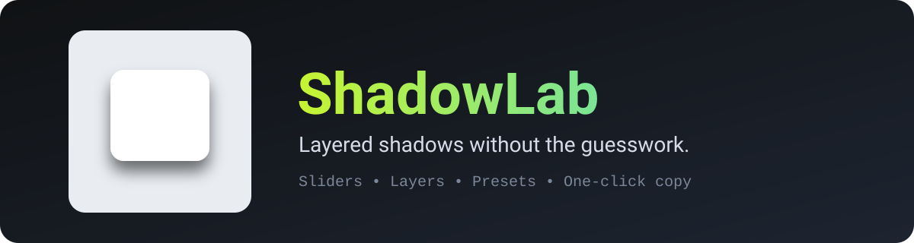
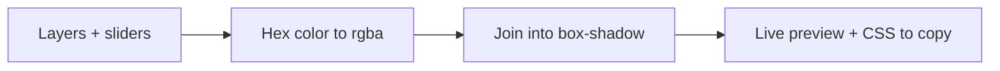

<p align="center"></p>

# ShadowLab 🌫️

**Layered shadows without the guesswork.** Move a few sliders, watch the box react, copy the `box-shadow` rule. ⚡

No accounts, no build step, no dependencies. Everything runs in your browser.

## ✨ What you get

- 🎚️ **Sliders** for X offset, Y offset, blur and spread
- 🧱 **Up to 4 layers**, because the best shadows are stacked
- 🎨 **Color and opacity** per layer, plus an **inset** switch
- 🖼️ **Page and box colors** so you can preview on your real background
- 🧁 **7 presets**: Soft, Layered, Lift, Hard, Glow, Inset, Neumorphic
- 📋 **One-click copy** of a clean, multi-line CSS rule
- 🌙 **Dark and light themes**, keyboard friendly, reduced-motion aware

## 🚀 Run it

```bash
git clone https://github.com/CyberLoop-dev/shadowlab.git
cd shadowlab
# open index.html, or serve the folder:
python3 -m http.server 8000
```

## 🧭 How it works



## 📁 Project structure

```text
shadowlab/
├── index.html
├── styles.css
├── app.js
└── assets/   # logo and README banner
```

## ⚠️ Known limitations

- It generates `box-shadow` only, not `text-shadow` or `filter: drop-shadow`.
- The box shape and size are fixed in the preview.

## 💡 Ideas for later

- Text-shadow and drop-shadow modes
- Adjustable preview box size and radius
- Tailwind export

## 🤝 Contributing

Issues and pull requests are welcome. Keep it dependency-free.

## 📄 License

[MIT](LICENSE)
